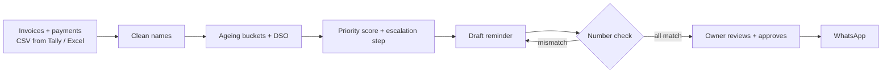

# CollectIQ

A receivables and collections assistant for Indian SMEs: it shows who owes you money, who to chase first, and drafts WhatsApp reminders whose numbers are checked against your books before you send them.

**Live demo:** https://prashantsingh-19.github.io/collectiq/

## The problem

Most Indian SMEs sell on credit. Dues are tracked in Tally or Excel, and chasing happens from memory: the owner calls whoever comes to mind, often the biggest account rather than the riskiest. Invoices slip past 60 and 90 days without anyone noticing, and cash that should be in the bank stays stuck with customers.

The sample business in this demo is Mehta Building Supplies, a building-materials distributor in Pune whose customers are local builders and contractors.

## What it does

1. **Read**: takes the invoice and payment export (CSV from Tally or Excel).
2. **Clean**: merges customer name variants, so "Kale Constrns." and "Kale Constructions" count as one customer.
3. **Age**: puts every open invoice in an ageing bucket (not yet due, 1–30, 31–60, 61–90, 90+ days) and calculates DSO.
4. **Rank**: scores each overdue customer by amount, lateness and payment history, and sets the next step.
5. **Draft**: writes a WhatsApp reminder for each customer, matched to how late they are.
6. **Check**: compares every amount, invoice number and day count in the draft with the customer's fact sheet. If any figure doesn't match, the draft can't be sent.
7. **Owner approves**: nothing goes out until the owner reads the draft and clicks approve.
8. **WhatsApp**: the approved message is sent, and a weekly briefing goes to the owner every Monday.

## How it works



| Measure | Formula |
|---|---|
| DSO (days sales outstanding) | receivables ÷ credit sales in the last 90 days × 90 |
| Priority score | 0.45 × overdue amount + 0.35 × days overdue + 0.20 × late-payment rate, each scaled 0 to 1 (amount relative to the largest overdue customer, days capped at 120) |
| Late-payment rate | share of a customer's invoices paid, or still unpaid, more than 15 days after the due date |
| Escalation step | 1–15 days overdue: friendly reminder · 16–45: firm reminder · 46–75: call today · over 75: pause new credit |

## Key design decisions

- **Code calculates, the language model only writes the wording.** Every amount, date and day count comes from deterministic code. The model is given a fact sheet and asked to phrase the message, never to work out a number.
- **The number check blocks mismatched drafts.** Each ₹ amount, invoice number and "N days" in a draft is matched against the fact sheet. One wrong figure disables the send button until it is fixed, so a typo or a made-up number can't reach a customer.
- **Rank by risk, not just by amount.** A large invoice that is 5 days late from a customer who always pays matters less than a smaller one that is 90 days late from a customer who is usually late. The score weighs all three.
- **The owner approves every message.** Collections messages affect customer relationships, so a person decides what gets sent.

## Try it

1. Open the [live demo](https://prashantsingh-19.github.io/collectiq/) and sign in with the prefilled demo login.
2. Open the **Collections queue** tab. Pick a customer and change one of the amounts in the draft to a wrong figure, for example ₹99,999. The number check flags it and **Approve & send** is disabled. Click **Reset draft** to restore it.
3. Or go to the **Upload data** tab and upload [`sample-data/invoices_sample.csv`](sample-data/invoices_sample.csv). The five steps run on your file, and the dashboard and queue update.

The CSV must have this header:

```
customer,invoice_no,invoice_date,due_date,amount,amount_paid
```

Dates are `YYYY-MM-DD`, amounts are plain numbers in rupees.

## Demo vs production

This demo runs all the calculations in JavaScript in the browser, using sample data, and sending is simulated: nothing leaves the page. The demo's "today" is fixed at 23 Oct 2026, so the sample data always gives the same results. The reminder drafts come from fixed templates filled from the fact sheet, which stand in for the language model.

The production design is:

- **Python + pandas** for reading, ageing, DSO and scoring
- **RapidFuzz** for matching customer name variants
- **Postgres** for invoices, payments, drafts and the send log
- **An LLM API** for drafting the wording from the fact sheet
- **APScheduler** for the Monday 8 AM briefing
- **WhatsApp Business Platform** with pre-approved message templates

## Tech stack (demo)

HTML, CSS, vanilla JavaScript, hand-drawn SVG charts. No build step and no dependencies apart from Google Fonts. Hosted on GitHub Pages.

## Author

Prashant Singh · MBA (Business Analytics), BITS Pilani

[Portfolio](https://prashantsingh-19.github.io/portfolio) · [LinkedIn](https://www.linkedin.com/in/prashant-singh-in)

Released under the [MIT License](LICENSE).
